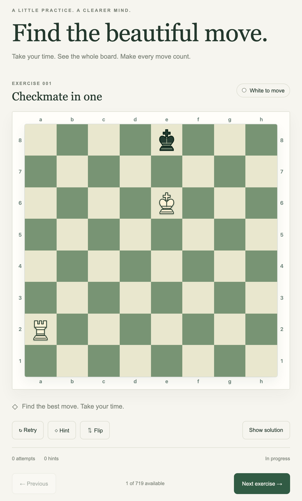
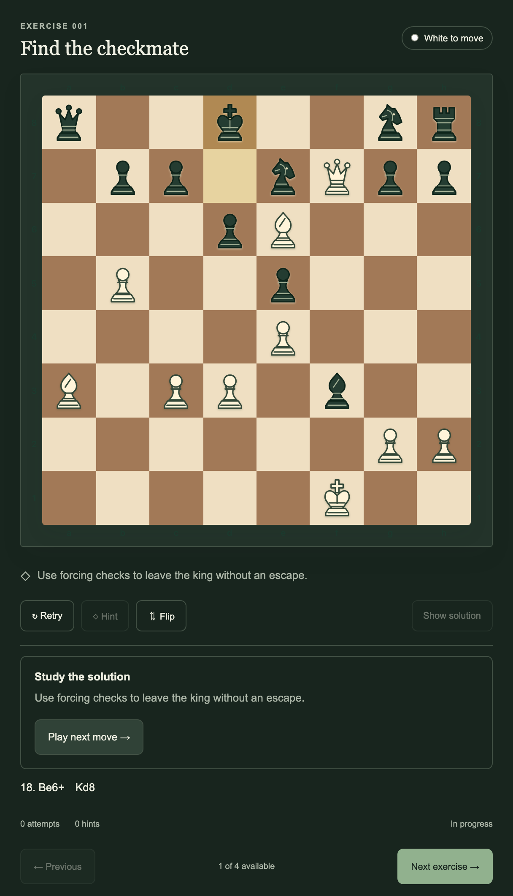
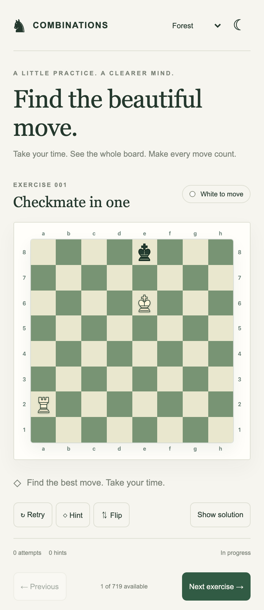

# ♞ Chess Combinations Trainer

Find the beautiful move. Build your chess confidence one puzzle at a time.

A relaxed, interactive place to practice checkmates, winning combinations, and drawing ideas. Study the board, try your move, and learn from immediate feedback. Start with a simple finish or challenge yourself with a longer tactical sequence.

**[▶ Play now](https://kunonuk.github.io/chess-combinations-trainer/)** · [How to play](#how-to-play) · [Controls](#make-it-your-own) · [Screenshots](#take-a-look)

Play in your browser on a computer, tablet, or phone. You can get started without creating an account or installing anything.

## How to play

1. **Open the trainer.** A puzzle is ready as soon as the page loads.
2. **Read the goal and check whose turn it is.** The heading tells you what to find, and the badge shows White or Black to move.
3. **Make your move.** Click or tap a piece, then its destination. On a computer, you can also drag the piece.
4. **Follow the combination.** Correct moves can trigger an automatic opponent reply. Keep going until you complete the puzzle.
5. **Try another challenge.** Choose **Next exercise**, or use **Stage & chapter** and **Exercise** in the collection panel to pick a topic or jump to a position. On a phone, scroll below the board to find that panel.

Take your time. Before moving, look for checks, captures, and threats. If you get stuck, ask for a hint or explore the solution at your own pace.

## Make it your own

| Control                      | What it does                                              |
| ---------------------------- | --------------------------------------------------------- |
| **Hint**                     | Gives a clue; ask again for more help.                    |
| **Show solution**            | Opens the solution so you can study the idea.             |
| **Play next move →**         | Steps through the revealed line one move at a time.       |
| **Retry**                    | Restarts the position while keeping your attempt history. |
| **Flip**                     | Shows the board from the other side.                      |
| **Previous / Next exercise** | Moves between puzzles in the selected collection.         |
| **Board**                    | Switches between Forest and Walnut colors.                |
| **☾ / ☀**                    | Switches between light and dark appearance.               |

<strong>Prefer a keyboard?</strong>

Press **Tab** to reach the board, then use the **arrow keys** to move between squares. Press **Enter** or **Space** to select a piece, move to the destination with the arrows, and press **Enter** or **Space** again. **Escape** cancels your selection.

## Pick up where you left off

Your completed puzzles, attempt history, last visited exercise, and appearance preferences are remembered when your browser allows it. Come back later and continue your practice.

Solving with a hint still counts as completion. First-try credit is reserved for a correct, unassisted solve without mistakes or retries. Solution playback is for learning and does not award a solve.

Use the same browser and device to pick up your progress. Clearing your browsing data also clears your progress. Use **Reset study progress** in the collection panel whenever you want a fresh start; a confirmation appears before anything is cleared.

## Take a look

Real screenshots from the [live trainer](https://kunonuk.github.io/chess-combinations-trainer/). Click an image to see it at full size.

|                                                                                 Study a solution in dark mode                                                                                 |                                                                                   Practice on your phone                                                                                    |
| :-------------------------------------------------------------------------------------------------------------------------------------------------------------------------------------------: | :-----------------------------------------------------------------------------------------------------------------------------------------------------------------------------------------: |
|  |  |

**[Ready for your next move? Open the trainer →](https://kunonuk.github.io/chess-combinations-trainer/)**
