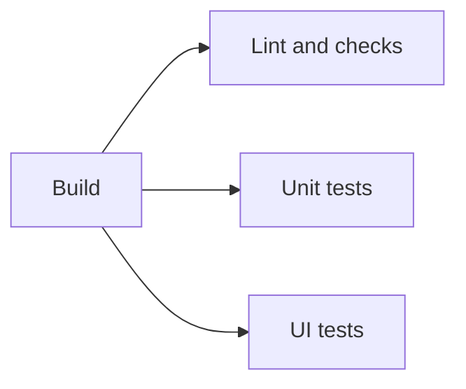

# Build and test CI

The `CI` workflow runs on pull requests targeting `main`, pushes to `main`, manual dispatches and merge-queue groups. Its four jobs appear separately in GitHub Actions:



## Jobs

| Job             | Work                                                                                      |
| --------------- | ----------------------------------------------------------------------------------------- |
| Build           | `npm run build`: strict TypeScript check and production build; upload `dist/`.            |
| Lint and checks | ESLint, formatting and puzzle-data validation.                                            |
| Unit tests      | Run all Vitest tests, including component tests.                                          |
| UI tests        | Download Build's artifact and run headless desktop/mobile Chromium against the built app. |

The three downstream jobs each declare `needs: build`. They run in parallel after Build succeeds. A failed Build skips them; a failure in one downstream job does not cancel the other two.

Each job checks out the same workflow revision and installs the committed lockfile with Node 24/npm 11. npm's download cache is shared through `actions/setup-node`; `node_modules` is installed separately for each runner. Ubuntu 24.04 is pinned to keep the runner platform consistent.

Build uploads an artifact named `production-build`, retained for one day. Missing build output fails the upload. UI tests download that artifact into `dist/` and use `playwright.ci.config.ts` to start Vite's production preview server. They do not rebuild or start the development server. A missing artifact fails the job.

Only UI tests install Playwright browser dependencies. The installer downloads Chromium's headless shell; desktop and mobile projects share that browser. Linux dependencies are still installed. Tests run with zero retries and preserve their HTML report, screenshots and traces for seven days on failure. Neither an empty test suite nor a failed command is treated as passing.

Public CI validates the complete bundled book collection in `src/data/book.json` and the separate attributed CC0 practice collection. The book audit requires all 719 original exercise IDs and checks every scored solution and unscored study line through the engine and playback. Source PDFs, scans, intermediate audit files and optional local packs are not supplied to the public workflow.

## Required merge checks

Require these four exact check names from the GitHub Actions app:

- **Build**
- **Lint and checks**
- **Unit tests**
- **UI tests**

Build must be required as well: GitHub accepts skipped required checks, and a failed prerequisite skips downstream jobs. None of these jobs has a job-level condition or path filter that could skip its work after a successful Build.

Keep the existing requirements for an up-to-date source branch, administrator enforcement and a PR. No additional reviewer approval is required. Force pushes and branch deletion remain disabled.

### Changing required check names

Workflow jobs and repository branch-protection requirements are configured separately. When replacing an older check name, publish the updated workflow first and wait for all new checks to report. Then replace the old requirement with the new exact names in one protection-rule update. Keeping the old requirement until the new workflow is available avoids PRs waiting for checks that cannot run yet.

Job names must remain unique across workflows and match the protection rule exactly. If a feature PR is behind `main`, update its branch and wait for its checks again. Do not bypass required checks.

## Local verification

`npm run verify` remains the local shortcut for types, lint, formatting, unit tests, puzzle data and build. To test the resulting production build with the same configuration used by UI tests:

```sh
npm run build
env -u PWDEBUG -u HEADED CI=true npm run test:e2e -- --config=playwright.ci.config.ts
```

The default `playwright.config.ts` still uses the local development server. Both configurations run headlessly and require port 4173 to be free.

This workflow does not deploy the site. Deployment remains separate from the required merge checks.

GitHub references: [job dependencies](https://docs.github.com/en/actions/how-tos/write-workflows/choose-what-workflows-do/use-jobs), [sharing build artifacts](https://docs.github.com/en/actions/tutorials/store-and-share-data), [required status checks](https://docs.github.com/en/repositories/configuring-branches-and-merges-in-your-repository/managing-protected-branches/about-protected-branches#require-status-checks-before-merging). Playwright reference: [headless-only browser installation](https://playwright.dev/docs/browsers#chromium-headless-shell).
